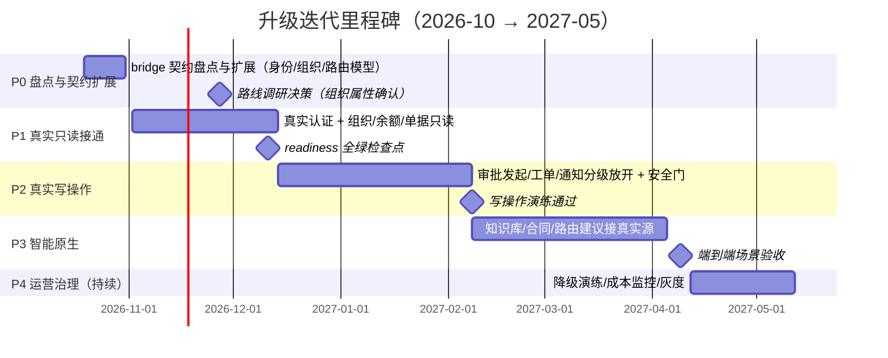

# OA 智能体系统 → 正式 OA 系统：升级决策与迭代计划 V1.0

> 编制：2026-10-15 ｜ 编制人：Victor（项目管理） ｜ 配套阅读：《OA系统升级建议与AI智能体示例调研.md》（同日，9 产品调研、官方来源已实测）
> 状态：待评审 ｜ 待确认项见 §5

---

## 1. 升级判断（结论先行）

**1. 项目缺的不是智能层，是 OA 本体。**
LangGraph 编排、HITL 门、幂等键、对账、可降级、工具白名单、审计全部就绪且经过 420 项回归验证；`OA_PROVIDER=mock` 背后的真实组织、流程引擎、消息渠道是空白。**升级的本质 = 把 `docs/real-oa-bridge.md` 的 13 个契约接口从 MockAdapter 换成真实实现，分级放开读与写**——不是推倒重来。

**2. 不必今天选边，但要给选边设 deadline。**
短期（0–3 月）做"真实化第一公里"（真实认证 + 只读接通），两条路线都必要、零沉没成本；但路线决策必须在 **2026-11-27**（P1 中期检查点）前敲定，否则 P2 写操作无法启动。

**3. 路线推荐（按目标组织属性二选一）：**

| 条件 | 推荐路线 | 理由 |
|---|---|---|
| 组织在用/愿用钉钉、企微、飞书，无强私有化要求 | **B1-SaaS 平台叠加**，首选**飞书"三方审批同步"模式** | 流程留在自研系统、飞书只做浏览与跳转，改造成本最小；组织/消息/审批即开即用，2–3 个月跑通第一个真实流程 |
| 央国企/政务/金融等私有化与数据主权要求 | **B2-私有化 OA 叠加**，首选**致远 AI-COP + CoMi** | CoMi 官方支持 OpenAI 兼容接口 + Function Calling + MCP（open.seeyoncloud.com），与本项目 LangGraph 栈无缝互嵌；备选泛微（大型集团市占第一）、蓝凌（知识管理最强） |
| 有持续研发团队 + 流程/数据模型完全可控的强诉求 | **A-自建**（Flowable/Camunda 流程引擎 + LDAP + 消息中心） | 12 个月+、长期人力投入高，仅在有强研发理由时选择 |

**4. 本项目的护城河不要丢**：bridge 的幂等键 + 写不自动重试先对账 + readiness fail-closed，这三点是相对厂商 SDK 的差异化设计，接任何底座都保留。

---

## 2. 成熟企业 OA 系统对比（精选 6 家 + 国际参考）

### 2.1 平台型 SaaS（即开即用）

| 维度 | 钉钉 | 企业微信 | 飞书 |
|---|---|---|---|
| 市场地位 | 协同平台第一（约 32.7%）【第三方报告】 | 第二（约 23.4%），独有微信 C 端连接 | 第三，文档/多维表格体验最好 |
| 审批 API | **最全**：20+ 接口（表单/实例/任务/附件/回调/AppLink） | 较少：applyevent + 模板查询（600 次/分） | 双模式：原生审批实例 + **三方审批同步**（最贴合本项目） |
| AI 能力 | AI 助理 + 工作流编排 + AI 听记 | 智能机器人（DeepSeek/混元）+ CLI/MCP | 飞飞/aily + 知识问答 API（旗舰） |
| 成本口径 | 专业版 ¥9,800/年起；专属版 ¥9.8 万/年起 | 基础免费，AI 计费未公开 | AI 点数包 18 万→2000 万点/年 |
| 对本项目改造成本 | 低（契约接口可直接映射） | 低 | **最低**（三方同步模式） |
| 数据主权 | 平台侧 | 平台侧 | 平台侧 |

### 2.2 私有化传统 OA（第一梯队，合计份额约 50%）

| 维度 | 泛微 e-cology | 致远 AI-COP + CoMi | 蓝凌 EKP |
|---|---|---|---|
| 定位与份额 | 政企/大型集团市占第一（约 25.7%） | 协同运营 + AI-COP，央国企覆盖广 | 金融行业第一，知识管理最强 |
| AI 开放度 | e-Builder 1000+ API/ESB；**无公开 AI 开发者站** | **最高：OpenAI 兼容 + Function Calling + MCP Client**，官方实测接 Dify/FastGPT/Coze | API + iPaaS + MCP 工具集；无公开开发者站 |
| 与本项目契合 | 中 | **最高**（LangGraph 可作为 CoMi 的模型/工具，反之亦然） | 中（知识问答场景可借鉴 aiKM） |
| 成本口径 | 渠道口径 50 用户约 17.5 万（非官方）；AI 报价未公开 | 官方口径私有化 15 万–120 万/套、SaaS 20–80 元/人/月；2025 年 AI 合同 2.07 亿【证券时报】 | 渠道口径约 15 万+/年（非官方） |
| 数据主权 | 私有化，最高 | 私有化，最高 | 私有化，最高 |

**国际参考**（选型思路借鉴，非候选）：ServiceNow 按 assists 价值计费、编排与 LangGraph 同构；M365 Copilot $30/人/月审批仍靠自建 agent；Salesforce 按 $2/解决计费。可作为未来"AI 用量内部计量"的计费对标。

---

## 3. 迭代路线图（里程碑）

> 排期为区间估算（单人后端 + 兼职前端的假设下），人力到位情况待确认后校准；每个里程碑 = 验收门，未过门不进入下一阶段。

### 关键任务拆解（P0–P2，1–2 天粒度示例）

| 任务 | 产出 | 负责人 | 截止 | 依赖 |
|---|---|---|---|---|
| 按目标 OA 真实能力盘点 bridge 13 接口缺口 | 缺口清单 | 后端 | 2026-10-23 | — |
| 确认审批路由模型（会签/或签/加签/条件）是否进契约 | 契约 V1.1 | 后端+产品 | 2026-10-30 | 盘点 |
| 身份映射表设计（unionid↔工号↔部门标签） | 设计文档 | 后端 | 2026-11-06 | 选定平台 |
| 真实认证接入（OAuth/LDAP） | AUTH_PROVIDER=real | 后端 | 2026-11-20 | 身份映射 |
| 组织/余额/单据只读接通 + 审计 | 只读测试用例全过 | 后端 | 2026-12-04 | 认证 |
| readiness 全绿验收 | 检查点报告 | 测试 | 2026-12-11 | 只读 |
| 幂等表 + 对账任务实现（真实写前置） | 代码+单测 | 后端 | 2026-12-24 | m2 |
| 审批发起写打通（HITL 保留） | 演练记录 | 后端 | 2027-01-16 | 幂等 |
| 通知渠道分级放开（邮件/IM） | 发送状态可查 | 后端 | 2027-01-30 | 审批写 |
| 写操作白名单/限流/操作前校验 | 安全门报告 | 后端+安全 | 2027-02-05 | 通知 |

---

## 4. 风险登记表（Top 6）

| # | 风险 | 概率 | 影响 | 应对策略 | 负责人 | 触发信号 |
|---|---|---|---|---|---|---|
| R1 | 身份/权限标签错位导致越权或漏权 | 高 | 严重 | 先做权限模型映射 + 最小权限验证用例集，未通过不放开任何功能 | 后端 | 三方登录后 unionid 与工号对不上 |
| R2 | 审批路由差异（真实会签/条件 vs mock 固定链） | 高 | 高 | AI 只做建议、路由只读透传，裁决权交 OA 权威 | 后端+产品 | 预检路由与真实流转不一致 |
| R3 | 真实写失败造成重复单据 | 中 | 严重 | 幂等键 + 先对账后重试（契约已定），写演练必测重放 | 后端 | 对账接口返回与本地状态不一致 |
| R4 | 平台 API 版本漂移/限流 | 中 | 中 | 适配层契约测试 + readiness 探测 + 熔断降级（已有设计） | 后端 | 开放平台变更公告/429 频发 |
| R5 | LLM 成本与延迟不可控 | 中 | 中 | 模型分级（快模型路由/摘要，慢模型合同）+ 用量计量（对标飞书点数/ServiceNow assists） | 运维 | 月度 token 成本超预算 20% |
| R6 | 路线决策拖延导致 P2 无法启动 | 中 | 高 | 决策 deadline 2026-11-27 硬卡；逾期升级到干系人拍板 | PM | 11-20 前组织属性仍无法确认 |

---

## 5. 待确认清单（决策前置，本周内收集）

| # | 待确认项 | 影响决策 | 责任方 |
|---|---|---|---|
| Q1 | 目标组织当前是否已用钉钉/企微/飞书？用哪家？ | 决定 B1 还是 B2 | 业务负责人 |
| Q2 | 是否有私有化/数据主权/等保信创硬要求？ | 决定 B1 vs B2/A | 安全/合规 |
| Q3 | 可投入研发人力（后端几人、是否全职）？ | 校准排期与是否选路线 A | 管理层 |
| Q4 | 预算上限（SaaS 订阅 vs 私有化买断 15 万起）？ | 决定 B2 可行性 | 管理层 |
| Q5 | 第一个真实流程选哪个？（建议：请假审批，最高频、影响最小） | P2 范围 | 产品 |
| Q6 | 目标用户规模（决定平台版本档位） | 成本测算 | 产品 |

---

## 6. 建议立即做的 3 件事

1. **本周（≤ 2026-10-23）完成 Q1–Q6 干系人访谈**，拿齐路线决策的输入——这是当前唯一的关键路径阻塞项。
2. **启动 P0 契约盘点**（2026-10-19 开工）：对照目标平台开放文档逐条核对 bridge 13 接口，产出缺口清单，不动代码。
3. **搭一个飞书/钉钉免费试用租户做接口沙箱验证**（1–2 天）：用只读接口实测组织/审批查询的真实返回结构，提前暴露 R1/R2 两类坑。
