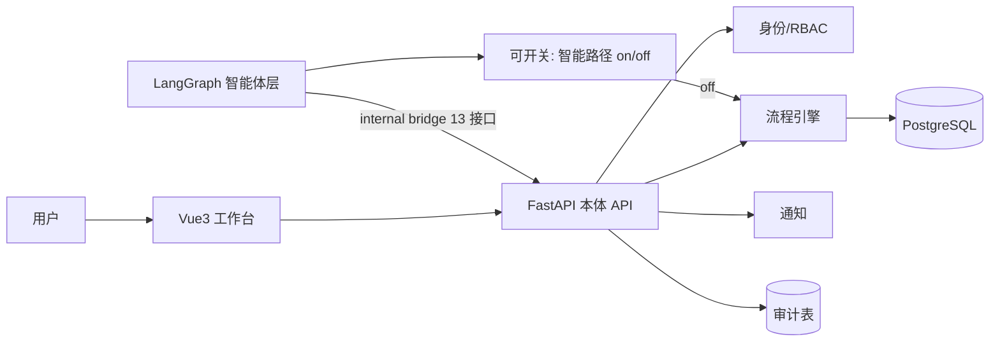
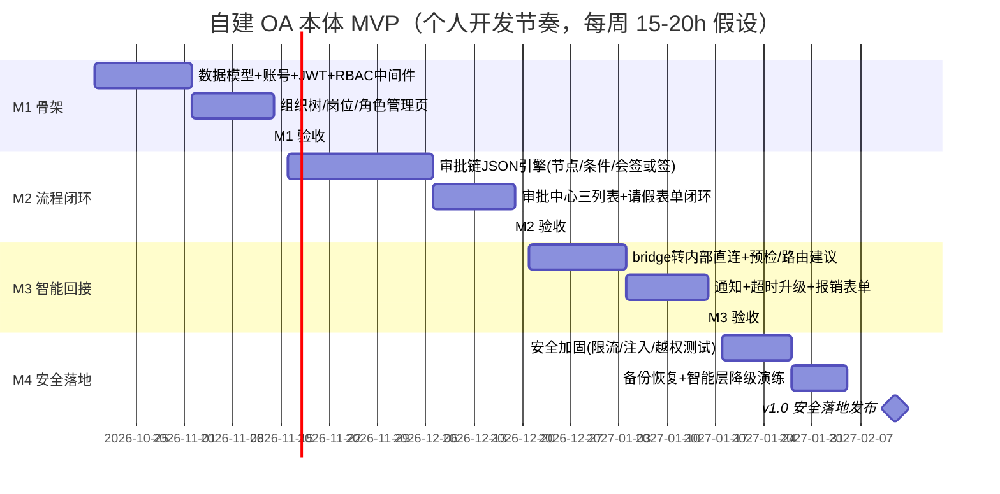

# 自建 OA 系统：个人开发版 MVP 范围与迭代计划 V1.0

> 编制：2026-10-16 ｜ 编制人：Victor（项目管理） ｜ 决策依据：用户拍板路线 A（自建本体），企业 OA 仅作实现手法参考
> 目标（SMART）：**2027-02-12 前**交付一个可安全试用的自研 OA 本体（身份/组织/审批/通知/审计闭环），智能体层直接叠在本体上运行，端到端走通"请假审批"与"制度问答"两个真实场景。
> 前提假设：个人开发，每周投入约 15–20 小时（**待确认**）；技术栈沿用 FastAPI + Vue3 + PostgreSQL + LangGraph。

---

## 1. 范围裁剪：哪些是"骨头"，哪些砍掉

### 1.1 必做核心（OA 骨头，六件缺一不可）

| # | 核心模块 | 缩量做法（个人版） | 对标手法（学思路不抄实现） |
|---|---|---|---|
| 1 | **身份认证与账号** | 本地账号 + 密码哈希（bcrypt/argon2）+ JWT + 登录失败限流；SSO/OAuth 延后 | 钉钉 unionid 体系 → 学其"一人一主键，多端映射"的账号模型 |
| 2 | **组织架构与 RBAC** | 部门树 + 岗位 + 角色 3 张表；权限 = 角色 × 资源 × 动作，接口级校验中间件 | 致远组织模型 → 学其"权限标签随人走"，数据权限先只做"本部门/本人"两档 |
| 3 | **流程引擎（自研轻量）** | 审批链 = JSON 配置（节点表：类型[审批/抄送]/审批人规则[直属上级/指定人/角色]/条件分支/会签或签/超时升级）；不做可视化拖拽编辑器 | 泛微/华天的复杂工作流 → 只学"条件路由 + 代理审批 + 幂等节点"三个机制 |
| 4 | **审批中心** | 待办/已办/我发起的 三个列表 + 审批卡片（同意/驳回/转办）+ 两个固定表单模板（请假、报销） | 飞书审批卡片 → 学其"卡片内直接操作 + 结构化展示预检结果" |
| 5 | **通知** | 站内消息 + 邮件（SMTP）；先不做 IM 推送 | 钉钉 DING → 学其"超时升级"而非全量推送 |
| 6 | **审计与可恢复** | 全写操作审计表（who/when/what/before/after）+ PostgreSQL 每日备份 + 幂等键 | ServiceNow → 学其"每次变更可回放" |

### 1.2 明确不做（V1 边界，防范围蔓延）

- 不做：考勤打卡、门户自定义、可视化流程设计器、移动 App（响应式 Web 即可）、多租户、SSO 对接第三方、电子签章、复杂报表
- 不做：把现有 P2/P3 智能功能（会议/邮件/合同）接进本体——本体稳定后再说
- 智能体层的**开关保留**：智能路径可一键关闭回退纯人工（这条是 PRD 已验证的设计，继承）

### 1.3 技术选型确认

| 组件 | 选择 | 理由 |
|---|---|---|
| 流程引擎 | **自研轻量 JSON 审批链**（不引 Flowable/SpiffWorkflow） | mock 阶段已有规则路由雏形，升级为持久化执行即可；BPMN 引擎学习成本对个人过高，且核心场景（请假/报销）不需要 BPMN 全量语义 |
| 认证 | 本地 JWT（access 2h + refresh 7d） | 无外部依赖，个人可控 |
| 前后端 | 沿用 Vue3 + TS + Element Plus / FastAPI | 已有工作台页面直接复用 |
| 数据库 | PostgreSQL 单库（业务 + 审计 + pgvector） | 已就绪，Docker 5433 |
| 部署 | Docker Compose 单机 + 每日 pg_dump + 卷快照 | 个人可运维的最小安全水位 |

---

## 2. 与智能体系统的关系（架构不变，桥变内桥）

原 `real-oa-bridge.md` 的 13 个契约接口保留语义，但实现从 MockAdapter 改为**进程内直连自研本体**（同库同事务，bridge 接口转 internal service 调用）。好处：幂等/对账/审计协议零改动；未来若要接外部 IM，bridge 层还能用。

---

## 3. 里程碑计划（2026-10-19 → 2027-02-12，约 17 周）

### M1–M2 关键任务拆解（1–2 天粒度）

| 任务 | 产出 | 负责人 | 截止 | 依赖 |
|---|---|---|---|---|
| 全量数据模型设计（用户/组织/角色/流程/单据/审计 6 域 ER） | ER 图 + Alembic 初版迁移 | 我 | 2026-10-23 | — |
| 账号注册/登录/JWT 刷新/登录限流 | auth 模块 + 单测 | 我 | 2026-10-30 | ER |
| RBAC 中间件（接口级权限校验） | 依赖注入式权限装饰器 | 我 | 2026-11-06 | auth |
| 组织树/岗位/角色 CRUD + 前端管理页 | 管理界面 3 页 | 我 | 2026-11-13 | RBAC |
| **M1 验收**：建 3 人组织、登录、越权访问被拦截 | 验收记录 | 我 | 2026-11-13 | 上行 |
| 审批链引擎：节点执行器 + 状态机 + 幂等键 | engine 模块 + 20 条边界单测 | 我 | 2026-11-27 | M1 |
| 条件分支/会签或签/代理审批/超时升级 | 引擎规则表 + 单测 | 我 | 2026-12-07 | 节点执行器 |
| 请假表单 + 审批卡片 + 三列表页 | 前端 4 页 | 我 | 2026-12-14 | 引擎 |
| **M2 验收**：纯人工请假全流程（含驳回重提、超时升级） | 演练记录 | 我 | 2026-12-18 | 上行 |

> M3/M4 拆解在 M1 验收后细化（避免过早拆解产生废稿）；缓冲策略：每阶段预留 1 周弹性，任何一周实际投入 < 10h 即触发重排。

---

## 4. 风险登记表（个人开发版 Top 5）

| # | 风险 | 概率 | 影响 | 应对策略 | 触发信号 |
|---|---|---|---|---|---|
| R1 | **范围蔓延**（忍不住加功能，如门户/报表/IM） | 高 | 致命 | V1 边界 §1.2 白纸黑字；新想法一律记入 backlog 不进当前迭代 | 任何不在 M1–M4 计划内的编码 |
| R2 | 单点人力中断（本职工作忙/生病） | 中 | 高 | 每周投入 < 10h 持续两周 → 立即砍 M3 智能回接，先保 M2 纯人工闭环上线 | 周日晚自查投入工时 |
| R3 | 自研引擎埋安全漏洞（越权审批/绕过权限） | 中 | 严重 | 每模块过一遍 OWASP Top10 自查清单；审批操作必须服务端二次校验身份与权限，不信任前端 | 单测覆盖 < 80% 引擎路径 |
| R4 | 流程引擎语义不足（真实需求撞上简化模型） | 中 | 中 | 先用请假+报销两个高频单据验证模型；引擎节点表设计留扩展位（节点类型枚举可加） | 第三个业务单据建模困难 |
| R5 | 数据丢失/无法回滚 | 低 | 严重 | 从 M1 起就上每日 pg_dump + 每周恢复演练一次（10 分钟脚本化） | 恢复演练失败 |

---

## 5. 待确认清单

| # | 待确认项 | 影响 | 责任方 |
|---|---|---|---|
| Q1 | 每周实际可投入小时数（假设 15–20h） | 排期成立性 | 我/用户 |
| Q2 | V1 是否需要多用户真实试用（即：给谁用？自己/小团队） | 决定 M4 验收标准与账号规模 | 用户 |
| ~~Q3~~ | ~~部署环境~~ → **已确认：本机 Docker（2026-10-16）** | 无公网暴露；邮件通知需配 SMTP；未来给他人试用需内网穿透或迁云 | — |
| Q4 | 报销表单是否 V1 必要（可延到 V1.1 换 1 周缓冲） | M3 范围 | 用户 |

---

## 6. 建议立即做的 3 件事

1. **2026-10-19（下周一）开工 M1 第一个任务**：全量数据模型 ER 设计——这是所有后续工作的地基，1–2 天产出。
2. **把 §1.2 "不做清单"存为项目的 V1 边界文档**，任何新想法先入 backlog 排期再动工——个人项目死于范围蔓延的概率远高于死于技术。
3. **回答 Q1–Q4**（尤其每周投入小时数），我据此校准排期；若每周 < 10h，M4 发布日期顺延到 2027-03 中旬，提前告诉你而不是中途爆雷。
