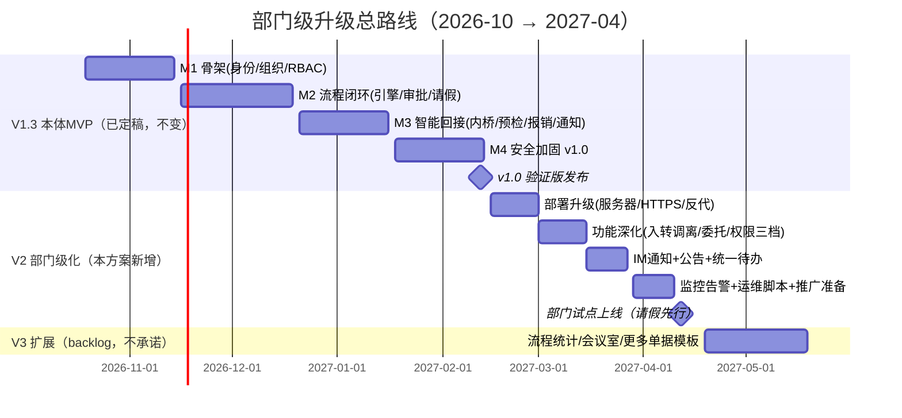

# 自建 OA 系统 · 部门级升级方案 V1.0

> 编制：2026-10-17 ｜ 编制人：Victor ｜ 决策前提（用户已确认）：  
> ① 目标定位**部门级**；② 上线前不涉及真实隐私数据负载（隐私合规项延后至上线前检查清单）；③ 长期运维从简（提供脚本化轻量运维，不做 7×24 承诺）；  
> ④ 参考基准：《OA 系统详细介绍》（2025–2026 市场全景，八大功能模块 + 六层架构 + 七步实施路径）。  
> 配套文档：《正式PRD V1.3》《自建OA系统-MVP范围与迭代计划-V1.0》《OA系统升级建议与AI智能体示例调研》

---

## 1. 方案概述

本方案回答一个问题：**从"智能体辅助底座 + 待建 OA 本体"出发，如何走到"部门级可用的 OA 系统"**。

核心思路：以《OA 系统详细介绍》给出的标准 OA 能力全景为对照系，**不追求功能清单打勾，只取部门真实高频场景**（参考文档避坑原则第 1 条："从最痛的流程问题出发"）。分三个阶段推进，每个阶段交付一个可独立使用的版本：



---

## 2. 能力全景对照：参考文档八大模块 → 本项目取舍

对照《OA 系统详细介绍》§3 的八大功能模块，逐项标注"在哪一步、怎么做"：

| 标准模块                 | 本项目处置     | 阶段      | 实现手法                                                                                                 |
| -------------------- | --------- | ------- | ---------------------------------------------------------------------------------------------------- |
| **3.1 流程管理**（OA 的心脏） | **核心，全做** | V1.3    | 自研 JSON 审批链：条件路由/会签或签/代理/超时升级/催办；请假+报销两个模板打样。**不做**：可视化拖拽编辑器（JSON 配置够用）、电子签章（部门级用线下手签+扫描归档替代）        |
| 3.1 流程监控与统计          | 简版        | V3      | 审批时长、瓶颈环节统计页（SQL 聚合即可，不做 BI）                                                                         |
| **3.2 公文与文档**        | 取一半       | V2      | **制度库/文档中心简版**：复用智能层已有的 pgvector 知识库 + 权限过滤，增加"制度库"入口与文档版本管理；**不做**：公文流转（非政企场景）、合同库（P3 合同审查工作台已独立存在） |
| **3.3 协同沟通**         | 不自研，借力    | V2      | IM 即时通讯不自研——**通知推送接企业微信/钉钉群机器人**（部门用户已在 IM 上）；站内通知+邮件保留；视频会议不做（用腾讯会议）                                |
| 3.3 通知公告             | 简版        | V2      | 公告发布 + 已读统计（单表+页面，1 周工作量）                                                                            |
| **3.4 日程与任务**        | 已有大半      | 已交付     | P3 任务管理智能体已实现（提取/跟踪/提醒）；会议室预约 → V3 backlog；OKR 不做                                                    |
| **3.5 行政人事**         | 取高频       | V2      | **入转调离**（至少入职/离职，联动账号禁用与数据交接）纳入 V2；考勤打卡**不做**（部门级强需求才进 V3）；用车/用品/访客 → backlog                        |
| **3.6 知识管理**         | **差异化强项** | 已交付+V2  | 智能层 RAG 问答（带来源引用）即参考文档所说的"AI 智能问答"新一代能力——这是本系统相对传统 OA 的**最大差异点**，V2 将制度库接入后价值放大                      |
| **3.7 门户与移动端**       | 裁剪        | V2      | 不做 App/小程序；响应式 Web 覆盖手机浏览器；**统一待办**做简版（待办中心聚合审批/任务两类）；门户定制不做，固定首页                                    |
| **3.8 系统管理**         | **核心，全做** | V1.3+V2 | RBAC/审计 V1.3 交付；数据权限三档、操作日志增强 V2；不做 ERP/CRM 集成（部门级无此依赖）                                              |

**取舍原则**：八大模块中"流程 + 系统管理"是骨架（V1.3 全做），"知识管理"是差异化亮点（已建成，V2 放大），"协同沟通"借力 IM 不自研，"公文/考勤/门户定制/签章"明确不做。裁掉的功能约占标准产品功能面的 40%，换来的是个人开发 6 个月可达部门级试点的可行性。

---

## 3. 目标架构（部门级形态）

对照参考文档 §6 六层架构的裁剪版：

```
┌──────────────────────────────────────────────┐
│ 接入层：响应式 Web（PC+手机浏览器）              │
│         + 企微/钉钉群机器人（通知出口）           │
├──────────────────────────────────────────────┤
│ 应用层：流程审批 | 报销 | 通知公告 | 制度库       │
│         | 统一待办 | 知识问答 | 任务跟踪         │
├──────────────────────────────────────────────┤
│ 平台层：自研审批链引擎 | 表单模板 | 组织权限(RBAC) │
│         | 消息推送 | 审计                       │
├──────────────────────────────────────────────┤
│ AI 层（差异化）：预检 | 路由建议 | RAG 知识问答    │
│   | 催办编排 |（LangGraph + HITL 审批门，可开关）│
├──────────────────────────────────────────────┤
│ 数据层：PostgreSQL 业务+审计 | pgvector 知识向量 │
├──────────────────────────────────────────────┤
│ 基础设施：部门内网服务器，Docker Compose 单机    │
│   Nginx + HTTPS | 每日备份（本机+异机一份）      │
└──────────────────────────────────────────────┘
```

与 V1.3 架构的差异只有两处：**基础设施从本机迁到部门内网服务器**、**接入层增加 IM 机器人出口**。应用层与 AI 层代码完全复用——这是"先做对、再做大"路线的红利。

## 4. V2 部门级化详细设计

### 4.1 部署升级（2027-02-15 → 02-26，2 周）

| 项     | 方案                                         | 说明                       |
| ----- | ------------------------------------------ | ------------------------ |
| 服务器   | 部门内网实体机或虚拟机，4C8G 起步，Linux + Docker Compose | 50–100 人、日几百单据，单机余量充足    |
| 接入    | Nginx 反向代理 + HTTPS（内网 CA 或自签证书）            | 全站强制 HTTPS               |
| 数据库   | 沿用 PostgreSQL 16 容器，数据卷独立                  | 每日 pg_dump 本机 + 每周异机拷贝一份 |
| 可用性目标 | **工作时间可用**（工作日 8:00–18:00），非工作时间可维护        | 提前与部门约定，不做双机热备           |
| 升级方式  | 镜像版本化 + Alembic 迁移 + 回滚脚本                  | 发版选在下班后，窗口 ≤ 15 分钟       |
| 监控告警  | 轻量方案：Uptime-Kuma（存活）+ 日志关键字告警（邮件/IM 通知管理员） | 不搭 Prometheus 全家桶        |

### 4.2 功能深化（2027-03-01 → 03-12，2 周）

| 功能      | 设计要点                                   | 对应 PRD 编号 |
| ------- | -------------------------------------- | --------- |
| 入转调离    | 入职=建账号+归属部门+角色；离职=账号禁用+待办转交+数据留存（审计不删） | 新增 F-160  |
| 审批委托/代理 | 请假期间指定代理人，受托审批留"代批"标记                  | 新增 F-161  |
| 数据权限三档  | 本人/本部门/跨部门审批可见（第三档仅审批链上下文可见，不做自由查询）    | F-105 扩展  |
| IM 通知   | 企微/钉钉群机器人 Webhook：审批到达/催办/公告推送；站内+邮件保留 | F-140 扩展  |
| 通知公告    | 发布/撤回/已读统计，全员可见或指定部门                   | 新增 F-162  |
| 统一待办    | 待办中心聚合：流程审批 + 任务管理两类待办                 | 新增 F-163  |

### 4.3 试点推广计划（2027-03-15 → 04-12）

裁剪参考文档 §9 的七步实施路径为个人开发者版：

| 步骤 | 动作                          | 时间            | 成功标志                 |
| -- | --------------------------- | ------------- | -------------------- |
| 1  | 真实组织数据配置（部门/岗位/人员导入）        | 03-15 → 03-19 | 组织树与实际一致             |
| 2  | 请假流程配置 + 3 条真实历史单据回放验证      | 03-22 → 03-26 | 回放结果与人工处理一致          |
| 3  | 管理员培训（即备份管理员）+ 用户 10 分钟上手指南 | 03-29         | 备份管理员能独立完成启停/备份      |
| 4  | **试点运行**：请假单场景，5–10 人，旧流程并行 | 04-05 → 04-30 | 试点单据 ≥ 20 条，无 P1 级故障 |
| 5  | 反馈收集与修复（每周一次）               | 滚动            | 周修复率 100%            |
| 6  | 制度绑定：部门发文"请假一律走系统"          | 试点满意后         | 高频流程线上化率 ≥ 90%       |
| 7  | 第二场景（报销）放量                  | 2027-05       | 同上                   |

> 成功关键沿用参考文档结论：**高频流程先跑通、流程宁简勿繁、上线后有"制度绑定"推动**。并行运行期旧流程不停，杜绝"上新系统卡住没人管"的风险。

## 5. 验收标准（部门级试点）

| 编号    | 场景     | 通过标准                                   |
| ----- | ------ | -------------------------------------- |
| AC-D1 | 部署与访问  | 内网 HTTPS 访问正常；手机浏览器可完成审批               |
| AC-D2 | IM 触达  | 审批到达/催办/公告经 IM 机器人 10 秒内送达             |
| AC-D3 | 入转调离   | 离职账号禁用后不可登录、待办已转交、历史单据与审计完整            |
| AC-D4 | 审批委托   | 委托生效期间受托人可批且留"代批"标记                    |
| AC-D5 | 数据权限三档 | 跨部门审批上下文可见、自由查询被拒                      |
| AC-D6 | 可用性    | 试点期工作日 8:00–18:00 可用率 ≥ 99%（允许计划内维护窗口） |
| AC-D7 | 备份恢复   | 异机备份存在；恢复演练 ≤ 15 分钟                    |
| AC-D8 | 试点规模   | ≥ 20 条真实请假单据闭环，无数据丢失                   |

## 6. 风险登记表（部门级增量）

| #    | 风险              | 概率 | 影响 | 应对                                                | 触发信号              |
| ---- | --------------- | -- | -- | ------------------------------------------------- | ----------------- |
| R-D1 | 单人维护、无人备份       | 高  | 高  | 运维全脚本化；培训备份管理员（AC 于 03-26 前完成）                    | 03-19 前未找到备份管理员人选 |
| R-D2 | 服务器资源/网络条件不落实   | 中  | 高  | 02-15 前确认服务器与内网策略（端口/证书）；未落实则试点推迟，不降级裸奔           | 02-12 服务器未到位      |
| R-D3 | 用户不用（习惯迁移失败）    | 中  | 高  | 并行运行 + 高频场景先行 + 制度绑定；试点期每周访谈                      | 试点 2 周单据量 < 10 条  |
| R-D4 | IM 机器人权限/审核受阻   | 低  | 中  | 提前在测试群验证 Webhook；备选方案为邮件+站内                       | Webhook 被管理员限制    |
| R-D5 | 隐私数据上线前突击       | 中  | 中  | 虽然上线前无隐私负载，**上线前 1 周执行隐私检查清单**（最小化收集、留存期限、备份文件保管） | 试点前未执行清单          |
| R-D6 | 范围蔓延（试点期被要求加功能） | 高  | 中  | 试点期只修不加；新需求一律 V3 backlog                          | 试点期出现新功能编码        |

## 7. 待确认清单

| #      | 待确认项                                                   | 影响                | 截止         |
| ------ | ------------------------------------------------------ | ----------------- | ---------- |
| ~~Q1~~ | ~~内网服务器~~ → **已确认：部署整体延后至项目完成后（V2 阶段）处理**，V1.3 开发期不受影响 | V2 部署方案仍按 §4.1 执行 | —          |
| Q2     | 部门 IM 用企微还是钉钉（机器人 Webhook **均可借用**，无需认证；深集成需管理员开通自建应用） | V2 通知渠道选择         | 2027-02-12 |
| Q3     | 试点部门/人选（5–10 人）与部门负责人支持度                               | 推广计划              | 2027-02-26 |
| Q4     | 每周投入小时数（沿用 15–20h 假设？）                                 | 全局排期              | 尽早         |
| Q5     | PRD 是否随本方案升 V1.4（并入 V2 范围 F-160~163 与 AC-D 系列）         | 文档一致性             | 2026-10-23 |

## 8. 建议立即做的 3 件事

1. **回答 Q1–Q4**（尤其服务器与 IM 归属），它们决定 V2 的两个外部依赖是否成立——这是当前唯一不在你代码掌控内的路径。
2. **2026-10-19 按 V1.3 计划开工 M1**：全量数据模型 ER 设计（本方案未改动 V1.3 任何任务与排期，ER 设计需预留 §4.2 的 V2 字段扩展位：员工状态、代理人、部门层级深度）。
3. **把 §2 的"不做清单"同步给潜在试点部门负责人**，提前对齐预期（没有考勤、没有 App、没有公文），避免试点期被推翻范围。
