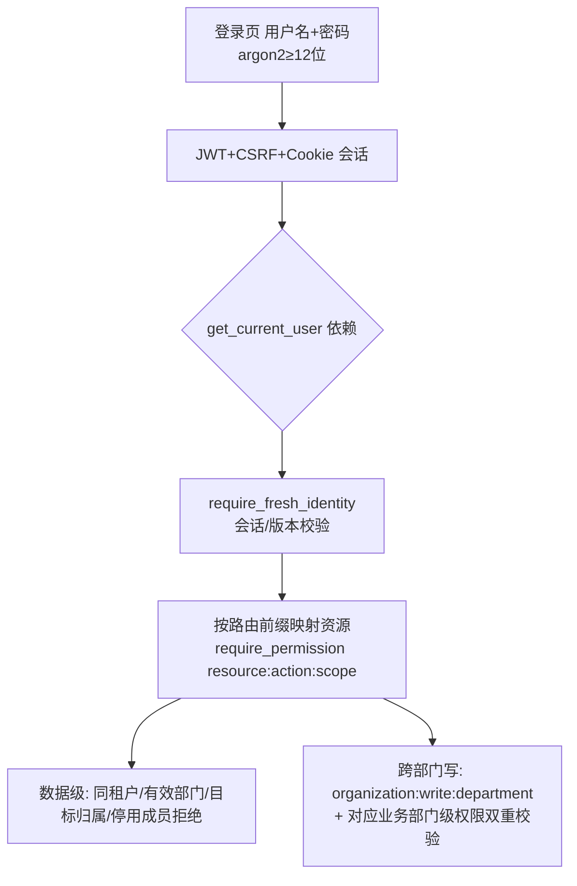

# OA 智能体管理系统 · 业务全景、身份权限与智能体作用说明（正式版）

> 依据 **2026-10-26** 项目代码与验收文档重新盘点（backend/app/api/routers、services、api/deps.py、frontend/src/navigation.ts、stores/auth.ts、docs/formal-oa-local-setup.md、real-business-acceptance.md、meeting-management.md、management-people-acceptance.md）。
> 适用环境：**正式模式**（AUTH_PROVIDER=builtin + OA_PROVIDER=builtin），前端 `http://127.0.0.1:5182`，后端 `http://127.0.0.1:8015`，数据库 `oa_agent_test`（迁移至 `0035`）。

---

## 〇、运行模式（与旧 mock 版的差异）

| 维度 | 旧版（mock） | **当前正式版** |
|---|---|---|
| 认证 | `AUTH_PROVIDER=mock`，演示账号一键切换，无密码 | **`AUTH_PROVIDER=builtin`**：正式账号 + 密码（argon2，≥12 位）+ JWT + CSRF + Cookie 会话，拒绝匿名/Mock 凭证 |
| OA 业务 | `OA_PROVIDER=mock`，静态假数据 | **`OA_PROVIDER=builtin`**：项目自身提供 OA 业务权威（请假/报销/工单/审批/流程/额度/委托），不依赖外部 Bridge |
| 主模型 | ARK doubao | **`deepseek-flash`（主）+ doubao-seed-2-1-turbo（兜底）**，嵌入 `doubao-embedding-vision-251215`（1024 维） |
| 通知 | 仅平台内 | **站内信 + QQ 邮箱 SMTP + 企业微信机器人 webhook**（已实测收到，幂等去重） |
| 会议 | 纯文本纪要 | **+ 腾讯视频会议（TUIRoomKit/TRTC）**，服务端签发限时 UserSig、按需建房间 |
| 业务入口 | `/leaves /approvals /ticket /support` 等 | builtin 下这些旧入口**隐藏/503**，改用 `/oa/*` 正式工作台 |

> 账号：管理员 `oa_admin`（初始口令保存在 `output/formal-oa-private/initial-admin.env`，登录后请修改）；其余成员由"组织管理"建号。组织当前有 8 个部门、9 位候选成员（验收记录）。

---

## 一、业务模块全景（按前端导航六大分组）

### 1. 工作台

| 模块 | 入口 | 后端路由 | 作用 | 走智能体 |
|---|---|---|---|---|
| 我的任务 | `/tasks` | `/api/tasks` | 统一待办中心：审批、工单、业务任务等汇聚（`oa/work-items` 读取待办需 approval/work_task 读权限） | ⚠️ 展示智能体发起的流程 |
| 通知与站内信 | `/oa/notifications` | `oa_notifications` | 站内信 + 投递记录（deliveries）+ 收件授权（contacts）；邮件/企微投递可重试 | ⚠️ 智能体写通知 |

### 2. 办公业务（正式 OA 工作台）

| 模块 | 入口 | 后端路由 | 作用 | 走智能体 |
|---|---|---|---|---|
| 我的申请 | `/oa/leaves` | `oa_leaves` | 请假申请/草稿/提交（内置 OA 单据） | ✅ 对话式发起 |
| 报销工作台 | `/oa/reimbursements` | `oa_reimbursements` | 报销单提交/审批/附件 | ✅（候选提取场景外） |
| 工单工作台 | `/oa/tickets` | `oa_tickets` | 正式工单：录入/处理（handle）/分派规则（rules 需 ticket_admin） | ✅ 对话式创建 |
| 审批工作台 | `/oa/approvals` | `oa_approvals` | 审批收件箱/办理（会签/或签/普通），办理人资格校验 | ❌ 人工决策 |
| 审批委托 | `/oa/delegations` | `oa_delegations` | **F-161** 员工自助委托：同部门、按请假/报销分别授权，最长 90 天，覆盖生效/到期/撤销、代批标记、防自审/链式委托 | ❌ |
| 请假额度 | `/oa/balances` | `oa_balances` | 额度查询/管理；管理名单按额度权限加载（**跨部门额度调整需双重授权**） | ❌ |
| 我的请假（旧） | `/leaves` `/leave` | —— | mock 专属入口，builtin 下隐藏 | ✅（旧） |
| 审批待办（旧） | `/approvals` | —— | mock 专属，builtin 下隐藏 | ❌ |
| 工单查询（旧） | `/ticket` | —— | mock 专属，builtin 下隐藏 | ✅（旧） |
| 客服队列（旧） | `/support` | —— | mock 专属，builtin 下 503 | ❌ |

### 3. 协同办公

| 模块 | 入口 | 后端路由 | 作用 | 走智能体 |
|---|---|---|---|---|
| 部门公告 | `/oa/announcements` | `oa_announcements` | **V2** 公告新建/编辑/发布/显式已读/撤回，受众按部门 | ❌ |
| 会议管理 | `/meetings` `/meeting-events/:id` | `meeting_events` `meetings` | **会议全流程**：发起（含腾讯视频开关）/邀请/反馈/开始/结束/取消/纪要关联；冲突提醒非资源预订；每场 ≤100 人 | ✅ 纪要生成 |
| 会议文本 | `/meeting-texts` | `meetings` | 纯文本纪要整理（原有流程保留） | ✅ |
| 文档起草 | `/documents` | `documents` | 文档模板生成/起草（真实模型） | ✅ |
| 邮件工作台 | `/emails` | `emails` | 邮件分析：分类/待办提取/回复草稿/HITL；无真实收发 | ✅ |
| 业务任务 | `/work-tasks` | `work_tasks` | 统一待办结果跟踪：负责人/截止/状态/逾期提醒；从纪要/工单提取候选 | ✅ 候选提取 |

### 4. 智能与知识

| 模块 | 入口 | 后端路由 | 作用 | 走智能体 |
|---|---|---|---|---|
| 智能助手 | `/assistant` | `threads` | SuperAgent：意图识别 → 请假/FAQ/工单子图；HITL + 幂等 + 审计 + 会话恢复 | ✅ 本体 |
| 知识库 | `/knowledge` | `knowledge` | 正式知识库（**已接真实来源**：6 个来源/6 版本/28 片段，GitLab 公开员工手册）；FAQ 检索阈值 **0.25**、意图阈值 **0.6** | ✅ FAQ |
| 合同审查 | `/contracts` | `contracts` | 四节点审查（提取→规则→风险→摘要）；**复核人改为真实成员**（修复 QA-20261023-01） | ✅ |

### 5. 数据报表

| 模块 | 入口 | 后端路由 | 作用 | 走智能体 |
|---|---|---|---|---|
| 只读报表 | `/reports` | `reports` | 注册指标（工单量/审批结果/业务任务进度）只读查询，禁自由 SQL，approve-plan 后执行 | ✅ 查询执行 |

### 6. 系统管理

| 模块 | 入口 | 后端路由 | 作用 | 走智能体 |
|---|---|---|---|---|
| 组织管理 | `/organization` | `organization` | 部门/岗位/成员/角色/重置密码；**成员生命周期与交接工作台（F-160）**：调部门/停用→交接清单→批量原子回滚 | ❌ |
| 运行告警 | `/organization/alerts` | `organization` | **V2** 运行告警：日志关键字监控、故障/恢复记录（仅 admin） | ❌ |
| 流程配置 | `/oa/workflows` | `oa_workflows` | 请假/报销流程定义、发布/回滚（options 需部门管理权限） | ❌ |
| 流程管理 | `/oa/administration` | `oa_administration` | 流程实例管理（workflow_admin） | ❌ |
| 来源治理 | `/knowledge/sources` | `knowledge`(version) | 文件上传→解析预览→草稿→发布→版本化（正式版已接通） | ❌ |
| 智能配置 | `/config` | `policies` | 场景策略（阈值/催办/升级） | ❌（驱动智能体） |
| 策略版本 | `/config/policies` | `policies`(version) | 策略版本生命周期（草稿→发布→回滚） | ❌ |
| 审计中心 | `/audit` | `audit` `audit_export` | 审计查询/导出（脱敏） | ❌ 记录端 |
| 运维观测 | `/operations` | `operations` | 指标/trace（**正式身份当前 503**，未完成正式组织隔离） | ❌ |
| 降级控制 | `/degradation` | `degradation` | 降级开关（同上 503） | ❌ |

---

## 二、身份与权限（正式版 builtin）

### 2.1 认证与权限模型



- 前端按 `permissions`（resource:action:scope 三元组）控制导航可见性；后端 `deps.py` 按路由前缀逐接口二次校验，**双端一致**；
- 拒绝会写审计 `identity.denied`；登录失败 5 次锁 15 分钟；JWT 会话支持轮换/撤销/重放检测；
- 关闭 AI 时（`ai_enabled=false`）仅保留组织/审批/流程/额度/报销/工单/通知/公告/会议等人工业务，智能体全场景不可用。

### 2.2 资源权限清单（builtin）

| 资源 | 覆盖业务 | 典型操作 |
|---|---|---|
| `organization` | 组织管理（部门/岗位/成员/角色） | 建号/改角色/重置密码/交接（跨部门写需 department:write 双重） |
| `leave` / `reimbursement` | 请假、报销申请 | 新建/提交/查询 |
| `approval` | 审批（含委托 delegations、待办 work-items） | 查看/办理/委托 |
| `workflow` / `workflow_admin` | 流程配置 / 流程管理 | 定义/发布/实例管理 |
| `leave_balance` | 请假额度 | 查询/管理（管理名单按权限加载） |
| `ticket` / `ticket_handle` / `ticket_admin` | 工单 | 查看/处理/规则 |
| `notification` / `notification_admin` | 通知/投递/收件授权 | 查收/管理投递与联系人 |
| `announcement` | 公告 | 发布/已读/撤回 |
| `meeting` | 会议 + 纪要 | 发起/主持/记录/纪要整理（主持人、记录人须写权限） |
| `document` / `email` / `work_task` / `report` / `contract` | 文档/邮件/业务任务/报表/合同 | 工作台读写 |
| `thread` / `task` | 智能助手会话/统一待办 | 对话/待办读取（approval 或 work_task 读权限即含 task） |
| `knowledge` / `policy` / `audit` / `operations` | 知识库/策略/审计/运维 | 读写/查询/导出（operations 正式隔离未完成） |

### 2.3 关键权限边界（验收确认）

- **跨部门管理不按角色名放行**：同时要求 `organization:write:department` + 对应业务部门级管理权限；仅有组织权限/普通部门管理/只读均不能跨部门写；
- 请假额度调整**拒绝停用成员**；合同复核人只列同租户、启用且具备合同读写权限的**真实成员**（不再有李四/王五/旧管理员）；
- 会议：未受邀或跨租户不可读，**管理员身份不自动获得会议访问权**；受邀成员须会议进行中凭限时凭证入会；
- 委托：仅同部门、按请假/报销分别授权、≤90 天；审批席位不复制，原审批人仍可本人处理；
- **尚未接通/门禁**：旧 `/leaves /approvals /tickets /support` 正式身份返回 503（等后续业务阶段）；`operations`/`degradation` 正式身份 503（未完成正式组织权限隔离）。

---

## 三、智能体目前发挥作用的业务（正式版）

### 3.1 总编排

```mermaid
graph LR
    U[用户消息/工作台触发] --> A[load_context 身份+降级开关]
    A --> B[classify_intent 意图分类<br/>阈值 0.6]
    B --> C{场景}
    C -- leave --> L[请假子图]
    C -- faq --> F[FAQ子图]
    C -- ticket --> T[工单子图]
    L --> X[审计收尾]
    F --> X
    T --> X
    F -- 未命中/低置信 → H[人工队列/正式手交]
```

独立专用图：会议 `meeting_graph`、合同 `contract_graph`、报表 `report_graph`、业务任务 `work_task_graph`；OA 原生模块另有 `oa_leave_graph_service` / `oa_ticket_graph_service` 承接对话式创建。

### 3.2 各业务：智能体做什么、人做什么

| 业务 | 智能体发挥的作用 | 人工环节 | 产出 |
|---|---|---|---|
| **请假/报销/工单** | 意图识别；读上下文/余额/表单校验/审批路由；生成单据草稿；**发起 OA 审批**；通知（站内信+邮件+企微） | 提交前 HITL 确认；审批人在工作台办理 | 正式 OA 单据、审批实例、通知投递 |
| **FAQ 问答** | 权限过滤向量检索（真实嵌入 1024 维）；阈值 0.25 判定；**仅依据证据回答+可点击来源引用**（定位段落高亮）；无证据拒绝推断/转人工 | 未命中/低置信/诱导问题转人工 | 带引用的回答 / 人工交接 |
| **会议** | 纪要生成（议题/决定/待办结构化）→ 人工确认；**从已确认纪要提取业务任务候选**（拒绝引用未确认片段） | 确认纪要；人工确认任务候选 | 确认版纪要、业务任务 |
| **文档** | 模板生成/起草（真实模型 6 类样例通过） | 人工编辑保存 | 文档草稿/成稿 |
| **邮件** | 规则分类（approval/meeting/work/notification）+ 待办提取 + 回复草稿；**不承诺负责人/期限/代执行** | HITL 确认 | 分析结果、草稿 |
| **业务任务** | 从会议/工单/审批上下文提取候选（谁/做什么/截止） | 人工采纳/执行 | 统一待办闭环 |
| **报表** | 只读注册指标执行（严格数字校验，叙述仅定性证据） | approve-plan | 指标结果 |
| **合同审查** | 四节点审查；证据需页码+引文+规则版本；长文走 DeepAgents | 真实成员复核人确认 | 审查报告（含风险点） |

### 3.3 智能体横切能力（与旧版一致并强化）

1. 意图理解与场景路由（显式场景优先，模型分类不能越权切换写操作）；
2. 确定性规则优先：余额/表单/审批链由代码与 OA 接口裁决；
3. 安全边界：工具白名单 + 写工具 HITL + 幂等键 + 审计全链路 + 脱敏；
4. 可降级：LLM 不可用/策略关闭 → 转人工或降级模式；关闭 AI 后人工业务照常；
5. LangGraph Checkpointer 会话恢复；`manual_review_required=true`、`production_acceptance=false` 标注未生产签收；
6. 证据可追溯：知识问答引用可点击定位、合同审查页码引文、会议任务引用已确认版本。

---

## 四、真实通知链路（已实测）

| 渠道 | 实现 | 验收状态 |
|---|---|---|
| 站内信 | 业务命令同事务生成（outbox） | ✅ 可查询 |
| QQ 邮箱 | SMTP（smtp.qq.com，STARTTLS） | ✅ 本人确认收到（2026-10-22 投递记录） |
| 企业微信机器人 | webhook（qyapi.weixin.qq.com，绑定项目部门） | ✅ 本人确认群内收到（同工单幂等重跑不重复发送） |

> 通知链接当前为 `127.0.0.1:5182`，跨设备点击/手机审批待网络部署后验证；请假审批/报销/催办的真实成员通知仍需分别核验。

---

## 五、当前状态与已知限制（2026-10-26）

| 项目 | 状态 |
|---|---|
| 后端回归 | 全量 1291 项通过（隔离库 `oa_business_m3_test`，业务库未重置）；最新 97 项管理名单专项通过 |
| 前端 | 36 文件 / 190 项通过；类型检查与生产构建通过（主包 >500 kB 提示保留） |
| 数据库 | `oa_agent_test` 迁移至 `0035`（0030 起扩部门权限 64 字符、公告/委托/交接/会议视频等） |
| 真实数据 | 有效成员 1（oa_admin）、组织 8 部门 9 候选成员、发布知识版本 6、请假单 0（验收记录除外） |
| 已知阻塞 | ① 合同复核人候选源（QA-20261023-01，已改真实成员待复测）；② 运维观测/降级/客服队列正式身份 503；③ 附件扫描未接入（未扫描附件禁止提交） |
| 待办门槛 | 真实部门试用（PRD 目标 5–10 人、≥20 条真实请假闭环）、HTTPS/手机/跨设备访问、持续备份、钉钉未接通（企微已启用，无需重复接入） |

---

## 六、一句话总结

**当前项目 = 自建正式 OA（builtin 权威业务）+ 真实认证 + AI 编排层（LangGraph 多场景）**：员工用真实账号登录，在 `/oa/*` 工作台与智能助手里完成请假/报销/工单/审批/会议/文档/邮件/任务/报表/合同全链路；智能体负责把自然语言变成有权限、有审计、需人工确认的业务动作，并通过站内信/邮件/企微真实触达；审批决策、组织/流程/额度/公告管理属人工侧。旧 mock 演示入口在正式模式下已隐藏/禁用，项目已进入"正式化本地试点 + 逐项补验收"阶段。
